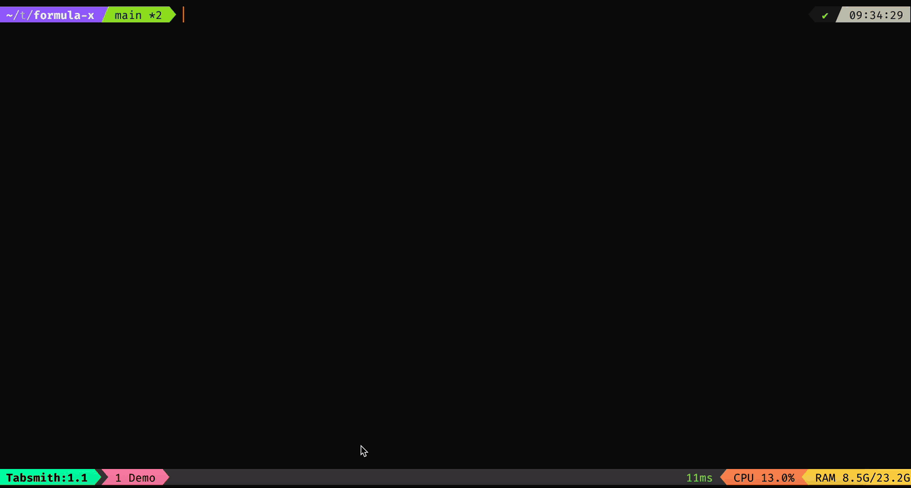

<h1 align="center">tabsmith</h1>

<p align="center">
  <strong>IDE-style autocomplete for your terminal.</strong><br>
  A dropdown menu of subcommands, options and arguments as you type, plus inline gray “ghost text” suggestions.<br>
  Written in Rust, it runs on macOS, Linux and Windows.
</p>

<p align="center">
  <a href="https://github.com/PedroLaRosa/tabsmith/actions/workflows/ci.yml"></a>
  <a href="https://github.com/PedroLaRosa/tabsmith/releases/latest"></a>
  <a href="#licence"></a>
  <a href="#supported-platforms"></a>
</p>

<p align="center">
  <a href="#install">Install</a> ·
  <a href="#first-run">First run</a> ·
  <a href="#keys">Keys</a> ·
  <a href="#commands">Commands</a> ·
  <a href="#settings">Settings</a> ·
  <a href="#update">Update</a> ·
  <a href="#uninstall">Uninstall</a> ·
  <a href="CONTRIBUTING.md">Contributing</a> ·
  <a href="SECURITY.md">Security</a>
</p>

<p align="center">
  
</p>

> **Amazon killed [Fig](https://github.com/withfig/fig). tabsmith brought it back from the ashes to make it shine again.**

## Features

- **Dropdown menu** drawn inside the terminal, right under the cursor (or above it at the bottom of the screen).
  See [Keys](#keys) for how to drive it.
- **Hundreds of CLIs out of the box** (git, docker, npm, kubectl, aws, terraform, cargo, …). The Fig-format
  completion specs from [`@tabsmith/autocomplete-specs`](https://www.npmjs.com/package/@tabsmith/autocomplete-specs)
  are embedded and run in QuickJS, including dynamic suggestions: git branches, npm scripts, docker containers,
  files and folders.
- **Inline ghost text** from your history and the specs, optionally backed by an LLM (OpenAI-compatible or
  Anthropic) with your own key. See [LLM ghost text](#llm-ghost-text-optional).
- **Works where you work**: zsh, bash, fish and PowerShell, over SSH and inside tmux.

### Supported platforms

| | |
| --- | --- |
| **Shells** | zsh · bash ≥ 4.4 · fish ≥ 3.3 · PowerShell 7 (`pwsh`) |
| **macOS** | 11+, Apple Silicon and Intel |
| **Linux / WSL** | Any distribution on x64 or arm64, Alpine included (static musl binaries) |
| **Windows** | 10+, x64 or arm64 |

## Install

**macOS, Linux, WSL**

```sh
curl -fsSL https://github.com/PedroLaRosa/tabsmith/releases/latest/download/install.sh | sh
```

**Windows PowerShell**

```powershell
irm https://github.com/PedroLaRosa/tabsmith/releases/latest/download/install.ps1 | iex
```

**Windows cmd**

```bat
curl -fsSL https://github.com/PedroLaRosa/tabsmith/releases/latest/download/install.cmd -o install.cmd && install.cmd && del install.cmd
```

The installer downloads the binary for your platform, checks it against the release's `SHA256SUMS` and puts it at
`~/.local/bin/tabsmith` (`%USERPROFILE%\.local\bin\tabsmith.exe` on Windows, added to your user `PATH`). On a first
install it runs `tabsmith setup`, which adds the shell integration to your dotfiles (it asks first).

<details>
<summary>Install a specific version</summary>

Pass the version to the installer:

```sh
curl -fsSL https://github.com/PedroLaRosa/tabsmith/releases/latest/download/install.sh | sh -s 0.2.0
```

```powershell
& ([scriptblock]::Create((irm https://github.com/PedroLaRosa/tabsmith/releases/latest/download/install.ps1))) 0.2.0
```

```bat
install.cmd 0.2.0
```

</details>

### Homebrew (macOS, Linux)

Installs from the [tap](https://github.com/PedroLaRosa/homebrew-tap). Homebrew updates this copy; it does not update
itself.

```sh
brew install pedrolarosa/tap/tabsmith
tabsmith setup                # adds the shell integration to your dotfiles (asks first)
```

### From source

Needs Rust 1.85 or later. Installs to `~/.cargo/bin/tabsmith`; this copy does not update itself.

```sh
git clone https://github.com/PedroLaRosa/tabsmith.git && cd tabsmith
cargo install --path .
tabsmith setup                # adds the shell integration to your dotfiles (asks first)
```

## First run

Open a new terminal tab and start typing. If suggestions don't show up, run `tabsmith doctor`: it checks everything.

### Editing your rc file yourself

Answer `n` to `setup`: it prints the exact _pre_ line for the very top and _post_ line for the very bottom of
`~/.zshrc`, `~/.bashrc` (or `$PROFILE` for pwsh) and writes the script files they source. `doctor` and `uninstall`
recognise those lines.

Sourcing the integration directly also works:

```sh
eval "$(tabsmith init zsh pre)"     # top
eval "$(tabsmith init zsh post)"    # bottom
```

but `doctor` then reports the integration as missing, and its automatic fix adds the standard lines as well.

For fish, run `tabsmith integrations install dotfiles fish` (it writes `conf.d/00_tabsmith_pre.fish` and
`99_tabsmith_post.fish`).

## Keys

**Dropdown menu**

| Key                         | Action                         |
| --------------------------- | ------------------------------ |
| `↑` `↓` / `Ctrl-N` `Ctrl-P` | Move the selection             |
| `Enter`                     | Insert the selected suggestion |
| `Tab`                       | Insert the common prefix       |
| `Esc`                       | Hide the menu                  |
| `Ctrl-R`                    | History mode                   |
| `Ctrl-K`                    | Description pop-out            |

**Ghost text**

| Key                               | Action                |
| --------------------------------- | --------------------- |
| `→` / `End` / `Ctrl-E` / `Ctrl-F` | Accept the suggestion |
| `Alt-F` / `Ctrl-→`                | Accept one word       |

Rebind any of the dropdown keys with [`autocomplete.keybindings.*`](#settings).

## Commands

| Command                                                                        | What it does                                                                        |
| ------------------------------------------------------------------------------ | ----------------------------------------------------------------------------------- |
| `tabsmith settings [KEY] [VALUE]`                                              | Get/set a setting (`-d` deletes, wildcards allowed; `list`, `list --all`, `open`)   |
| `tabsmith theme [dark\|light\|system\|NAME]`                                   | Dropdown theme (`--list`, `--folder` for custom JSON themes)                        |
| `tabsmith inline enable\|disable\|status`                                      | Inline ghost text on/off                                                            |
| `tabsmith inline set-customization [NAME]`                                     | Ghost text source: `history+specs` (default), `history`, `specs`, or an LLM profile |
| `tabsmith inline show-customizations`                                          | List the sources                                                                    |
| `tabsmith integrations install\|uninstall\|reinstall\|status dotfiles [SHELL]` | Manage the shell integration                                                        |
| `tabsmith init <shell> <pre\|post>`                                            | Print the integration code                                                          |
| `tabsmith doctor [--all] [--strict]`                                           | Diagnose and fix common problems                                                    |
| `tabsmith setup` / `tabsmith uninstall [--purge]`                              | Install / remove the integration                                                    |
| `tabsmith update`                                                              | Update a native install to the latest release                                       |
| `tabsmith diagnostic`, `tabsmith debug key-tester\|shell\|logs`                | Troubleshooting                                                                     |

## Settings

Stored in `~/.tabsmith/settings.json` (override the directory with `TABSMITH_HOME`). Highlights:

```sh
tabsmith settings autocomplete.disable true          # dropdown off (ghost text stays)
tabsmith settings autocomplete.fuzzySearch true
tabsmith settings autocomplete.onlyShowOnTab true    # open the menu with Tab only
tabsmith settings autocomplete.height 10             # rows; autocomplete.width = columns
tabsmith settings autocomplete.keybindings.tab insertSelected
tabsmith settings autocomplete.keybindings.control+k ignore
tabsmith settings beta.history.mode show             # mix history into the dropdown
```

`tabsmith settings list --all` prints every key with its type and default.

### LLM ghost text (optional)

Define a profile, then select it. API keys are read from environment variables only, never stored.

```sh
tabsmith settings inline.profiles.claude '{"provider":"anthropic","model":"claude-opus-5-5","api_key_env":"ANTHROPIC_API_KEY","effort":"low"}'
tabsmith settings inline.profiles.local '{"provider":"openai","model":"qwen2.5-coder","base_url":"http://localhost:11434/v1"}'
tabsmith inline set-customization claude
```

> [!NOTE]
> **What the LLM sees.** It is asked only when your history has no match. It receives the OS, shell, current
> directory and your last `inline.historyCount` (49) commands. Lines that look like they contain secrets
> (`password`, `token`, `api_key`, …) are filtered out first, and commands your shell keeps out of its own history
> (a leading space with `ignorespace`/`histignorespace`, fish private mode, PSReadLine's sensitive lines) are never
> recorded by tabsmith.

## Update

An install made with the one-liners updates itself: when a terminal tab opens, tabsmith looks for a newer release at
most once a day, in the background. It installs one only if its `SHA256SUMS` carries the release signing key's
signature and the binary matches it; the next tab runs the new version. What happened is logged to
`~/.tabsmith/logs/pty.log`.

```sh
tabsmith update                                    # update now
tabsmith settings app.disableAutoupdates true      # no background updates (tabsmith update still works)
```

A copy anywhere but `~/.local/bin` (Homebrew's, cargo's `~/.cargo/bin`, a `target/` build) is never touched. Update
it the way you installed it: `brew upgrade tabsmith` for Homebrew.

A binary you put at `~/.local/bin/tabsmith` yourself is the native install, so release builds replace it (unless
`app.disableAutoupdates` is set).

## Uninstall

`tabsmith uninstall` only takes the shell integration out of your dotfiles; the binary stays until you delete it.
Run it first, while `tabsmith` is still on your `PATH`:

```sh
tabsmith uninstall --purge     # --purge also deletes ~/.tabsmith (settings, specs, logs)
```

Then delete every copy you installed (`which -a tabsmith` lists them; a leftover copy keeps `tabsmith -V` working):

```sh
rm ~/.local/bin/tabsmith       # one-liner install (Windows: %USERPROFILE%\.local\bin\tabsmith.exe*)
brew uninstall tabsmith        # Homebrew
cargo uninstall tabsmith       # cargo install --path . / just install
```

Open a new terminal: `tabsmith -V` should now report `command not found`.

> [!TIP]
> An integration installed with `TABSMITH_HOME` set is only recognised with the same value:
> `TABSMITH_HOME=<dir> tabsmith uninstall`.

## Contributing

Bug reports, fixes and new features are welcome. [CONTRIBUTING.md](CONTRIBUTING.md) covers the development setup
(`just build`, `just test`, `just update-specs`), what CI checks, how the code is organised and the commit
conventions. Maintainers: see [docs/releasing.md](docs/releasing.md) for the release process.

## Security

Please don't report vulnerabilities in public issues. Use
[private vulnerability reporting](https://github.com/PedroLaRosa/tabsmith/security/advisories/new) instead;
[SECURITY.md](SECURITY.md) has the details and the supported versions.

## Licence

MIT OR Apache-2.0, at your option: [LICENSE-MIT](LICENSE-MIT), [LICENSE-APACHE](LICENSE-APACHE).

The bundled completion specs are © Hercules Labs (Fig), MIT — see [`assets/SPECS_LICENSE`](assets/SPECS_LICENSE).
